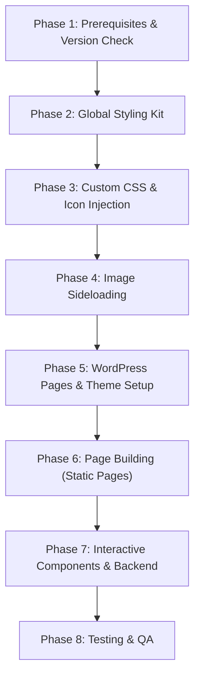

# Next.js → Elementor Migration Plan (v2 — Comprehensive)

> **Project:** Home Inspectors Nigeria Limited (HINL)  
> **Source:** Next.js 14 App Router + Tailwind CSS + React  
> **Target:** WordPress + Elementor (Free) via MCP  
> **MCP Servers:** `elementor-mcp`, `novamira-homeinspectors-n`  
> **Last Updated:** 2026-06-02

---

## 1. Page Inventory & Section Breakdown

### 1.1 Home Page — `app/page.tsx` (507 lines)

| Section | Layout | Key Elements | Complexity |
|:--------|:-------|:-------------|:-----------|
| Hero | Full-bleed bg image + gradient overlays + absolute-positioned floating stats | H1 with `<span class="text-primary italic">`, 3 CTA buttons, trust badges with icons, 5-star rating box, "100+" experience box | 🔴 High |
| Proof Strip | Sticky bar at hero bottom, `backdrop-blur-md` | 4 checkmark items in flex row | 🟡 Medium |
| The Problem | 2-col grid (text + image) | Error callout box (`bg-error/10 border-l-4 border-error`), overlay badge on image | 🟡 Medium |
| Construction Control | 12-col bento grid (8+4) | 5 feature cards with icon boxes, floating overlay card on image with `animate-pulse` dot | 🔴 High |
| Home Inspection | 2-col reversed order grid | 2×2 icon mini-grid, `grayscale hover:grayscale-0` image filter | 🟡 Medium |
| Trust & Authority | 3-col card grid, centered heading | 3 hover-lift cards (`hover:-translate-y-2`), callout strip | 🟢 Low |
| Positioning | 3-col (2+1) with `glass-panel` | 3 icon-text rows, 2 stat boxes ("0%", "100%") | 🟡 Medium |
| Final CTA | Centered, rounded container | 2 CTA buttons, 3 contact items (phone/web/email), background watermark icon | 🟡 Medium |
| Final Line | Full-width `bg-primary` banner | Single bold line of text | 🟢 Low |

**Uses:** `Navbar`, `Footer`, `Icon` (30+ instances)

---

### 1.2 About Page — `app/about/page.tsx` (316 lines)

| Section | Layout | Key Elements | Complexity |
|:--------|:-------|:-------------|:-----------|
| Hero | 80vh bg image + gradient | Label + H1 + paragraph | 🟢 Low |
| Who We Are | Centered text + 4-col phase grid | Connector line (`absolute top-1/2 w-full h-px`), staggered offset cards (`md:mt-12`), hover color-change icons | 🔴 High |
| Vision & Mission | 2-col (text blocks + image) | Green `bg-primary` Vision box, bordered Mission box, image with `mix-blend-multiply` overlay | 🟡 Medium |
| Value Pillars | 5-col grid | 5 icon cards with hover state | 🟢 Low |
| Leadership | 2-col (image + bio) | `grayscale hover:grayscale-0` image, absolute-positioned name overlay on `bg-primary`, social links | 🟡 Medium |
| Testimonials | Carousel component | `TestimonialCarousel` — JS-driven `translateX` slider with auto-advance timer | 🔴 High |
| Footer | 4-col grid | Logo, contact info with icons, legal links, decorative dots | 🟡 Medium |

**Uses:** `Navbar`, `Icon`, `TestimonialCarousel`

---

### 1.3 Services Page — `app/services/page.tsx` (646 lines, **LARGEST**)

| Section | Layout | Key Elements | Complexity |
|:--------|:-------|:-------------|:-----------|
| Hero | Centered text over bg image | Label + H1 + paragraph | 🟢 Low |
| Inspection Band | 320px image strip with overlays | `animate-pulse` dot, overlaid text | 🟡 Medium |
| Core Pricing Grid | 4-col card grid | 4 tier cards with badges, feature checklists (`check_circle` icons), recommended highlight (`border-2 border-primary shadow-xl`) | 🔴 High |
| New Construction | 2-col cards | 2 phase cards with CTA | 🟢 Low |
| Construction Control | 2-col text+image then 2-col tier cards | "Best for" lists, dual pricing display, overlay badge | 🔴 High |
| Commercial | Full-width card with inline CTA | Row layout with feature grid | 🟡 Medium |
| Add-Ons Grid | 4-col grid, 14 cards | Tag labels, "Coming Soon" badges, conditional styling | 🔴 High |
| Booking Section | 12-col (5+7) | Left: trust badges + image. Right: **`BookingForm`** component (stateful React) | 🔴 High |
| Footer | 4-col with newsletter | Input + send button, 4 link columns | 🟡 Medium |

**Uses:** `Navbar`, `Icon` (40+ instances), `BookingForm`

---

### 1.4 Diaspora Page — `app/diaspora/page.tsx` (271 lines)

| Section | Layout | Key Elements | Complexity |
|:--------|:-------|:-------------|:-----------|
| Hero | Full-height bg image + gradient | H1 (8xl on lg), 2 CTA buttons | 🟡 Medium |
| Core Protections | 4-col card grid | 4 icon cards with `border-l-2 hover:border-primary` | 🟢 Low |
| Diaspora Features | 12-col asymmetric (6+5 offset) | Aspect-ratio image, absolute-positioned "PropTech First" box on `bg-primary`, 3 feature rows | 🟡 Medium |
| Trust & Stats | 4-col stat counters | 4 large stat numbers, placeholder partner logos (4 grey bars) | 🟢 Low |
| CTA | Centered over faded bg image | 2 CTA buttons | 🟢 Low |
| Footer | Centered with "Precision Gauge" | Progress bar gradient (`from-error to-primary`), percentage label | 🟡 Medium |

**Uses:** `Navbar`, `Icon` (15+ instances)

---

### 1.5 Dashboard Page — `app/dashboard/page.tsx` (389 lines)

| Section | Layout | Key Elements | Complexity |
|:--------|:-------|:-------------|:-----------|
| Sidebar | `w-64 fixed left-0 top-0 h-screen` | Logo, 4 nav items with active state, "New Request" button, user profile area | 🔴 High |
| Header | Flex row between title and timestamp | Label + H1 with `<span>` color | 🟢 Low |
| Metrics Row | 12-col (4+4+4) | 3 stat cards with watermark background icons, `bg-primary` third card with inverted colors | 🟡 Medium |
| Featured Project | 12-col (7+5) split | Image with gradient overlay, "In Progress" badge, progress bar (75%), 4-phase tracker with conditional coloring, inspector note card with avatar | 🔴 High |
| Property Queue | 5-col (right side) | 3 status cards (Scheduled / Report Ready / Queued) with distinct badges and hover states | 🟡 Medium |
| Footer | Centered links | 3 links + copyright | 🟢 Low |

**Uses:** `Icon` (20+ instances). **Does NOT use `Navbar` or `Footer`** — has its own self-contained layout.

> [!IMPORTANT]
> The Dashboard must use **Elementor Canvas** page template to strip the theme header/footer. The sidebar must be built as a fixed-position flexbox container.

---

## 2. Design System & Token Mapping

### 2.1 Color Palette

| Token | Hex | Usage | Elementor Global Color |
|:------|:----|:------|:-----------------------|
| `primary` | `#65B32E` | Accents, CTAs, highlights | `gc-primary` |
| `on-primary` | `#ffffff` | Text on primary backgrounds | `gc-on-primary` |
| `surface` / `background` | `#121415` | Page backgrounds | `gc-surface` |
| `surface-container-lowest` | `#0d0f10` | Deepest containers | `gc-surface-lowest` |
| `surface-container-low` | `#1a1c1d` | Dark containers | `gc-surface-low` |
| `surface-container` | `#1e2021` | Medium containers | `gc-surface-container` |
| `surface-container-high` | `#282a2b` | Lighter containers | `gc-surface-high` |
| `surface-container-highest` | `#333536` | Lightest containers | `gc-surface-highest` |
| `on-surface` | `#e2e2e3` | Primary text | `gc-text-primary` |
| `on-surface-variant` | `#c2c8bb` | Secondary text | `gc-text-secondary` |
| `outline` | `#8a9480` | Muted text, borders | `gc-outline` |
| `outline-variant` | `#42493d` | Subtle borders | `gc-outline-variant` |
| `error` | `#ffb4ab` | Error states, warnings | `gc-error` |
| `surface-bright` | `#3a3c3d` | Bright surfaces | `gc-surface-bright` |

### 2.2 Typography

| Role | Font | Weights | CSS Variable | Elementor Config |
|:-----|:-----|:--------|:-------------|:-----------------|
| Headlines | Manrope | 400, 600, 700, 800 | `--font-manrope` | Global Typography → Headings |
| Body / Labels | Inter | 300, 400, 500, 600 | `--font-inter` | Global Typography → Body, Labels |

### 2.3 Custom CSS Classes to Migrate

These classes from `globals.css` need to be injected into WordPress via `execute-php` → `wp_enqueue_style` or Elementor Custom CSS:

| Class | Purpose | Migration Strategy |
|:------|:--------|:-------------------|
| `.material-symbols-outlined` | Google Material icon font rendering | Enqueue the Google Fonts stylesheet + add CSS rules |
| `.editorial-text-shadow` | `text-shadow: 0 4px 12px rgba(0,0,0,0.8)` | Add as Elementor Custom CSS on affected headings |
| `.editorial-grid` | 12-column CSS grid (`repeat(12, 1fr)`, gap 2rem) | Recreate using Elementor flexbox containers |
| `.bg-hero-pattern` | Background gradient over external image | Elementor background settings (image + overlay) |
| `.custom-scrollbar` | Custom webkit scrollbar styling | Inject via `wp_head` style block |
| `.glass-panel` | Glassmorphism (`rgba(30,32,33,0.7)` + `blur(12px)`) | Elementor custom CSS on containers |

---

## 3. Image Asset Audit

All 11 images in `public/images/` must be sideloaded to WordPress Media Library:

| # | Filename | Size | Used On |
|:--|:---------|:-----|:--------|
| 1 | `logo.png` | 37 KB | Navbar, Footer, Dashboard sidebar |
| 2 | `DSC06085-1024x683.jpg` | 162 KB | Home (hero), Services (hero) |
| 3 | `DSC06096-1024x683.jpg` | 79 KB | Home (problem), Services (band) |
| 4 | `DSC06135-scaled-*.jpg` | 60 KB | Home (inspection), Services (booking), About (hero) |
| 5 | `DSC06142-1024x683.jpg` | 147 KB | Home (construction control), Services |
| 6 | `DSC06168-1024x683.jpg` | 97 KB | Diaspora (CTA) |
| 7 | `DSC06174-1024x683.jpg` | 147 KB | Diaspora (hero) |
| 8 | `WhatsApp-*-8.42.14-PM-*.jpeg` | 217 KB | Dashboard (featured), Diaspora (tablet) |
| 9 | `WhatsApp-*-9.00.31-PM-*.jpeg` | 167 KB | About (president), Services (team) |
| 10 | `gh-1-*.jpeg` | 49 KB | About (vision) |
| 11 | `C1358T01-1.jpg` | 49 KB | Home (legal) |

**Tool:** `elementor-mcp-sideload-image` — returns attachment ID for each  
**Storage:** Map `{filename → attachment_id}` for referencing in `build-page` calls

---

## 4. Shared Component Strategy

### 4.1 Navbar (`components/Navbar.tsx`)

| Aspect | Next.js Implementation | WordPress/Elementor Strategy |
|:-------|:----------------------|:-----------------------------|
| Sticky positioning | `fixed top-0 w-full z-50` with `backdrop-blur-md` | Use WordPress theme's native header OR build Elementor Header template (requires Elementor Pro or Hello theme header) |
| Active link highlighting | `usePathname()` — client-side route matching | Not possible in Elementor without JS; use WordPress menu with `current-menu-item` CSS class |
| CTA button | "Book Your Inspection" → `/services#booking` | Link to `/services/#booking` on WordPress |
| Logo | `` | Sideloaded attachment |

> [!WARNING]
> The Navbar uses `usePathname()` (a React hook) for active-link detection. WordPress native menus handle this automatically via the `current-menu-item` class. If using Elementor's Nav Menu widget, this is built-in.

**Decision:** Use the WordPress theme's **global header** (configured via Appearance → Customize or Elementor's Theme Builder if Pro is available). This avoids rebuilding the navbar on every page.

---

### 4.2 Footer (3 variants exist!)

The app has **3 different footer implementations:**

| Page | Footer Type | Key Differences |
|:-----|:------------|:----------------|
| Home | Shared `Footer` component | Logo, 4 links (Privacy, Terms, Contact, FAQ), copyright |
| About | Inline 4-col footer | Logo + description + dots, Contact info with icons, Legal links, copyright |
| Services | Inline 4-col footer with newsletter | HINL branding, Company links, Legal links, Newsletter email input + send button, social icons |
| Diaspora | Inline centered footer + precision gauge | 3 links, copyright, progress bar gradient |
| Dashboard | Inline minimal footer | 3 links, copyright (inside `ml-64` main area) |

**Decision:** Build a **WordPress global footer** using the most complete version (Services footer) and customize per-page where needed. The Dashboard's inline footer will be part of its Canvas page build.

---

### 4.3 Icon (`components/Icon.tsx`)

```tsx
// Current implementation
<span className={`material-symbols-outlined ${className}`}
      style={fill ? { fontVariationSettings: '"FILL" 1' } : undefined}>
  {name}
</span>
```

**Migration:** 
1. Use `execute-php` to enqueue the Google Material Symbols stylesheet:
   ```php
   add_action('wp_enqueue_scripts', function() {
       wp_enqueue_style('material-symbols',
           'https://fonts.googleapis.com/css2?family=Material+Symbols+Outlined:opsz,wght,FILL,GRAD@20..48,100..700,0..1,-50..200&display=swap'
       );
   });
   ```
2. Use `<span class="material-symbols-outlined">icon_name</span>` in Elementor HTML widgets or Text Editor widgets with custom HTML mode.

---

### 4.4 TestimonialCarousel (`components/TestimonialCarousel.tsx`)

| Feature | Implementation |
|:--------|:---------------|
| Sliding | CSS `translateX` via React state |
| Auto-advance | `setInterval` every 8 seconds |
| Navigation | Prev/Next buttons |
| Content | 2 testimonials with quote, name, title, icon |

**Migration Options (ranked):**
1. **Elementor native Testimonial Carousel widget** (if available in the installed Elementor version)
2. **Custom HTML widget** with inline `<style>` and `<script>` that replicates the sliding behavior
3. **Static testimonial blocks** as a minimum viable fallback (no animation)

---

### 4.5 BookingForm (`components/BookingForm.tsx`)

| Feature | Implementation |
|:--------|:---------------|
| Fields | Name, Email, Service (select, 9 options), Date, Address (textarea) |
| Add-ons | 12 checkboxes in scrollable grid |
| Submission | `fetch("/api/book", { method: "POST" })` |
| State | Loading spinner, success confirmation with reset |
| Backend | `app/api/book/route.ts` → Resend API → email to `tentmaking25@gmail.com` |

> [!CAUTION]
> The backend uses **Resend** (a third-party email API) with `RESEND_API_KEY` env var. WordPress does NOT have Resend. We must replace this with `wp_mail()`.

**Migration Strategy:**
1. Use `execute-php` to register a custom shortcode `[hinl_booking_form]` that outputs the form HTML
2. Use `execute-php` to register a WordPress REST API endpoint `POST /wp-json/hinl/v1/book` that calls `wp_mail()` to send the booking email
3. The form's JavaScript `fetch()` will post to this new endpoint instead of `/api/book`
4. Embed the shortcode in the Services page via Elementor's Shortcode widget

---

## 5. Backend API Migration

### Current: `app/api/book/route.ts`

```typescript
// Uses Resend SDK
const resend = new Resend(process.env.RESEND_API_KEY);
await resend.emails.send({
  from: "HINL Bookings <onboarding@resend.dev>",
  to: "tentmaking25@gmail.com",
  subject: `New Booking: ${service} — ${name}`,
  html: `...HTML template...`,
});
```

### Target: WordPress REST API + `wp_mail()`

```php
// Register via execute-php
add_action('rest_api_init', function() {
    register_rest_route('hinl/v1', '/book', [
        'methods' => 'POST',
        'callback' => 'hinl_handle_booking',
        'permission_callback' => '__return_true',
    ]);
});

function hinl_handle_booking($request) {
    $data = $request->get_json_params();
    $to = 'tentmaking25@gmail.com';
    $subject = sprintf('New Booking: %s — %s', $data['service'], $data['name']);
    $headers = ['Content-Type: text/html; charset=UTF-8'];
    // Build same HTML template...
    wp_mail($to, $subject, $html, $headers);
    return new WP_REST_Response(['ok' => true], 200);
}
```

**Tool:** `execute-php` to inject this into the theme's `functions.php` or a custom plugin.

---

## 6. SEO Metadata Migration

Each Next.js page exports `metadata`. We must set equivalent WordPress SEO fields:

| Page | Title | Description | Tool |
|:-----|:------|:------------|:-----|
| Home | "HINL \| Architectural Precision Home Inspections Nigeria" | "Precision audits for residential and commercial assets..." | Set as WP Front Page title + Yoast/RankMath if installed |
| About | "About HINL \| Building Quality. Verified." | "Home Inspectors Nigeria Limited (HINL) is redefining..." | WP page title + meta |
| Services | "Pricing & Booking \| Home Inspection Nigeria Limited" | "Transparent pricing and precise technical audits..." | WP page title + meta |
| Diaspora | "Diaspora Services \| HINL" | "Wherever you are in the world, HINL acts as your eyes..." | WP page title + meta |
| Dashboard | "Property Monitoring Dashboard \| HINL" | "Precision oversight of your active inspections..." | WP page title + meta |

---

## 7. Execution Phase Plan



### Phase 1: Prerequisites & Version Check
1. Run `elementor-mcp-detect-elementor-version` — confirm ≥ 4.0 for Flexbox Container support
2. Check if Elementor Pro is installed (determines form widget availability)
3. Verify the active WordPress theme (Hello Elementor preferred for minimal interference)

### Phase 2: Global Styling Kit
1. `elementor-mcp-update-global-colors` — push all 14 color tokens
2. `elementor-mcp-update-global-typography` — configure Manrope (headings) + Inter (body)

### Phase 3: Custom CSS & Icon Injection
1. `execute-php` — enqueue Google Material Symbols font
2. `execute-php` — inject custom CSS: `.editorial-text-shadow`, `.glass-panel`, `.custom-scrollbar`, `color-scheme: dark`
3. `execute-php` — set `<body>` defaults: `background-color: #121415; color: #e2e2e3;`

### Phase 4: Image Sideloading
1. For each of the 11 images, call `elementor-mcp-sideload-image`
2. Build a `filename → attachment_id` lookup map
3. Verify all uploads via the WordPress media library

### Phase 5: WordPress Pages & Theme Setup
1. Create 5 WordPress pages: Home, About, Services, Diaspora, Dashboard
2. Set Home as the static front page (`Settings → Reading → A static page`)
3. Set Dashboard page template to **Elementor Canvas**
4. Set other 4 pages to **Elementor Full Width** (or Default, depending on theme)
5. Configure WordPress menus: Primary nav with Services, Diaspora Services, About + CTA button

### Phase 6: Page Building (Static Pages)
Build pages in order of complexity (easiest first for pipeline validation):

1. **Diaspora** (271 lines, mostly static) — validate the full pipeline
2. **About** (316 lines, moderate complexity) — test phase cards + leadership section
3. **Home** (507 lines, complex hero) — multi-section with floating elements
4. **Services** (646 lines, most complex) — pricing grids, add-ons, booking area
5. **Dashboard** (389 lines, Canvas template) — sidebar layout, progress bars

For each page, use `elementor-mcp-build-page` with a complete JSON structure covering:
- Flexbox container hierarchy
- Widget placement (heading, text-editor, image, html)
- Inline styling matching Tailwind → CSS mapping
- Responsive breakpoint adjustments (mobile/tablet)

### Phase 7: Interactive Components & Backend
1. **BookingForm shortcode** — `execute-php` to register `[hinl_booking_form]`
2. **Booking API endpoint** — `execute-php` to register REST route with `wp_mail()`
3. **TestimonialCarousel** — Elementor native carousel OR Custom HTML widget with JS
4. **Navbar active states** — WordPress menu `current-menu-item` CSS
5. **Hover interactions** — Elementor motion effects + Custom CSS for `hover:-translate-y-2`, `grayscale hover:grayscale-0`, etc.

### Phase 8: Testing & QA
1. Visual comparison: screenshot each Next.js page vs WordPress page
2. Mobile/tablet responsiveness in Elementor preview
3. Form submission test (booking form → email received)
4. All internal links updated (`/services#booking` → WordPress slugs)
5. SEO meta verification
6. Performance: check page load times (Elementor can be heavier than Next.js)

---

## 8. MCP Tool Mapping

| Task | MCP Tool | Server |
|:-----|:---------|:-------|
| Check Elementor version | `elementor-mcp-detect-elementor-version` | `elementor-mcp` |
| Set global colors | `elementor-mcp-update-global-colors` | `elementor-mcp` |
| Set global typography | `elementor-mcp-update-global-typography` | `elementor-mcp` |
| Upload images | `elementor-mcp-sideload-image` | `elementor-mcp` |
| Build full page | `elementor-mcp-build-page` | `elementor-mcp` |
| Add heading widget | `elementor-mcp-add-heading` | `elementor-mcp` |
| Add text widget | `elementor-mcp-add-text-editor` | `elementor-mcp` |
| Add image widget | `elementor-mcp-add-image` | `elementor-mcp` |
| Add flexbox container | `elementor-mcp-add-flexbox` | `elementor-mcp` |
| Add custom HTML | `elementor-mcp-add-atomic-widget` (type: html) | `elementor-mcp` |
| Execute PHP on server | `execute-php` | `novamira-homeinspectors-n` |
| Create/update WP pages | WordPress REST API via MCP | `novamira-homeinspectors-n` |

---

## 9. Risks & Gaps

| # | Risk | Severity | Mitigation |
|:--|:-----|:---------|:-----------|
| 1 | **Elementor Free lacks form widget** | 🔴 | Build form via PHP shortcode + REST API |
| 2 | **No Elementor Pro = no Theme Builder** | 🔴 | Must rely on theme's built-in header/footer OR inject via `execute-php` |
| 3 | **`backdrop-blur` not natively in Elementor** | 🟡 | Inject via Custom CSS on affected containers |
| 4 | **`animate-pulse` CSS animation** | 🟡 | Add `@keyframes pulse` via injected CSS |
| 5 | **`grayscale hover:grayscale-0` filter transitions** | 🟡 | Custom CSS on image containers |
| 6 | **Dashboard sidebar is `position: fixed`** | 🔴 | Canvas template + Custom CSS + flexbox container with `position: fixed` override |
| 7 | **12-column `.editorial-grid` layout** | 🟡 | Map to Elementor flexbox with percentage widths |
| 8 | **Progress bars (Dashboard: 75%, Diaspora: 99.9%)** | 🟡 | Custom HTML widget with inline styles |
| 9 | **About page connector line between phase cards** | 🟡 | Custom CSS pseudo-element or HTML widget |
| 10 | **Services page has 14 add-on cards** | 🟡 | Build via `build-page` JSON — tedious but straightforward |
| 11 | **`mix-blend-multiply` image overlay (About vision)** | 🟢 | Elementor image overlay + Custom CSS |
| 12 | **Newsletter form in Services footer** | 🟡 | HTML widget with Mailchimp/custom endpoint, or skip if not functional in Next.js |
| 13 | **Partner logo placeholders (Diaspora)** | 🟢 | 4 grey placeholder divs — easy to replicate |

---

## 10. Open Questions

> [!NOTE]
> These should be resolved before starting execution:

1. **Is Elementor Pro installed?** This determines whether we can use Theme Builder for global header/footer and the native Form widget.
2. **What WordPress theme is active?** Hello Elementor is ideal; other themes may inject unwanted styling.
3. **Is there a preferred WordPress email plugin?** The booking form needs `wp_mail()` to work. If the server's PHP `mail()` is not configured, we may need WP Mail SMTP.
4. **Should the Dashboard be fully functional or a visual mockup?** The Next.js dashboard uses hardcoded data — do we replicate it statically or wire it to real WordPress data?
5. **Do the "Coming Soon" add-ons (Virtual Reality, Title & Land Verification) need special handling?** Currently they're styled as disabled cards.

---

> [!TIP]
> **Recommended execution order:** Diaspora → About → Home → Services → Dashboard. Start with the simplest page to validate the MCP pipeline end-to-end before tackling the complex ones.

> [!WARNING]
> **Do NOT mix Elementor layout models.** Use only Flexbox containers (never legacy Section/Column). Ensure `elementor-mcp-build-page` is configured for the Flexbox container model.
